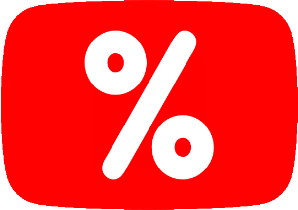
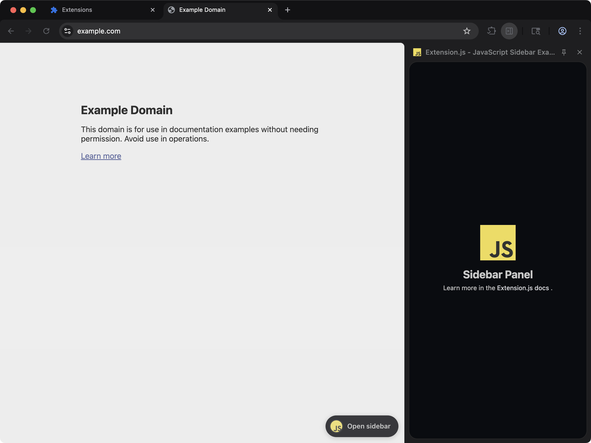

<div align="center">


# Ratio · YT

### **A lightweight browser extension & userscript that rates YouTube videos and filters low-rated videos.**  
### [Visit website at ratioyt.bittu.dev](https://ratioyt.bittu.dev)

<br>



<br>

</div>

## Install

| Platform | Link |
|---|---|
| **Chrome** | [Chrome Web Store](https://chromewebstore.google.com/detail/ratioyt) |
| **Firefox** | [Firefox Add-ons](https://addons.mozilla.org/firefox/addon/ratioyt/) |
| **Brave** | [Chrome Web Store](https://chromewebstore.google.com/detail/ratioyt) |
| **Edge** | [Edge Add-ons](https://microsoftedge.microsoft.com/addons/detail/ratioyt) |
| **Userscript** | [Install `ratioyt.user.js`](https://ratioyt.bittu.dev/ratioyt.user.js) |

Source builds and packages are also available on [GitHub Releases](https://github.com/Bittu5134/RatioYT/releases).

<br>

## Features

- **Extension or Userscript**: Install as a standalone browser extension or run as a lightweight userscript with full settings support.
- **Like/dislike ratios on cards**: Shown on Home, Search, Shorts, and sidebar recommendations.
- **Hide clickbait by score**: Videos scoring below your chosen threshold are replaced with empty placeholders.
- **Four rating formats**: Choose between Percentage (96%), 10-point (9.6/10), smileys (😊 😐 😞), or ★★★★★.
- **Red-to-green colouring**: Badge colour shifts with the score, so low and high ratings stand out at a glance.
- **Filter Only Mode**: Keeps low-rated video filtering active while hiding the score badges from your feed.
- **7-day local cache**: Ratings are stored in your browser's IndexedDB, so repeat visits don't hit the network.
- **Open source, no tracking**: Free software under GPL-3.0. Zero analytics, no accounts, and no telemetry.

<br>

## Settings

Settings can be managed from the extension popup or the web dashboard at [ratioyt.bittu.dev/popup](https://ratioyt.bittu.dev/popup/):

- **Score Format**: Percentage · 10-point ratio · Smiley faces · Star rating
- **Colour Scores**: Toggle dynamic red-to-green rating gradient
- **Filter Only Mode**: Filter low-rated videos silently without showing badges
- **Hide Low-Rated Videos**: Toggle auto-replacing low-scoring cards
- **Minimum Score**: Adjustable threshold slider (0–100%)

<br>

## Run Locally

Clone this Git repository locally and run these commands:

```bash
npm install
npm run dev
```

### Build

```bash
# Build browser extension (Chrome)
npm run build

# Build userscript
npm run build:userscript

# Build all targets
npm run build:all
```

<br>

## Built Using

[Extension.js](https://extension.js.org/) · [Return YouTube Dislike API](https://returnyoutubedislikeapi.com/) · [Vanilla JS](https://developer.mozilla.org/en-US/docs/Web/JavaScript)

<br>

---

<div align="center">

RatioYT · Free software under [GPL-3.0](https://github.com/Bittu5134/RatioYT/blob/main/LICENSE) · by [Bittu](https://bittu.dev)

[Website](https://ratioyt.bittu.dev) · [Discord](https://bittu.dev/discord) · [Email](mailto:hello@bittu.dev) · [Patreon ❤️](https://www.patreon.com/cw/LazyBittu)

</div>
