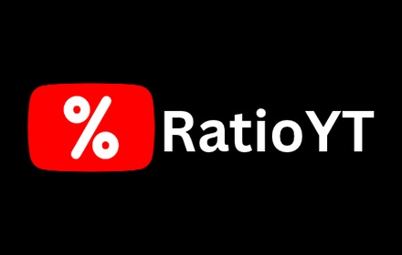

### A lightweight browser extension that rates YouTube videos and filters videos with low ratings. Read more at [ratioyt.bittu.dev](https://ratioyt.bittu.dev/)

## Install

        
        
        
        
        

        <strong>Pick your platform</strong>. Available as a browser extension or userscript. Source builds on <a href="https://github.com/Bittu5134/RatioYT/releases" target="_blank" rel="noopener">GitHub
          Releases</a>.
      

## Features

- **Like/dislike ratios on cards:** Shown on Home, Search, Shorts, and sidebar recommendations.
- **Hide clickbait by score:** Videos scoring below your chosen threshold are replaced with empty placeholders.
- **Four rating formats:** Choose between Percentage (96%), 10-point (9.6/10), smileys (😊 😐 😞), or ★★★★★.
- **Filter Only Mode:** Keeps low-rated video filtering active while hiding the score badges from your feed.
- **Customizable colouring:** Badge colour shifts with the score, so low and high ratings stand out at a glance.
- **Lightweight:** Runs efficiently in the background without slowing down your browser.
- **Extension or Userscript:** Install as a standalone browser extension or run as a lightweight userscript with full settings support.

## Contact

- **Potifolio:** [bittu.dev](https://bittu.dev/)
- **Email:** [hello@bittu.dev](mailto:hello@bittu.dev)
- **Discord:** [bittu.dev/discord](https://bittu.dev/discord)

If RatioYT is useful to you, you can support development on [Patreon](https://www.patreon.com/cw/LazyBittu).

## License

RatioYT is free software licensed under the [GPL-3.0](https://github.com/Bittu5134/RatioYT/blob/main/LICENSE) by [Bittu](https://bittu.dev)