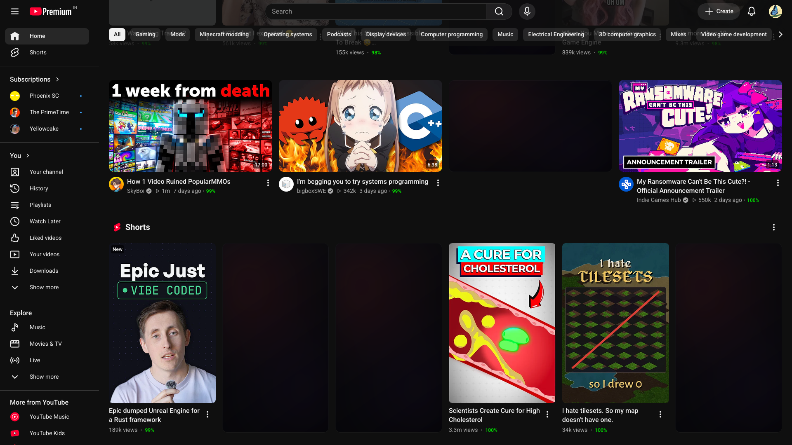
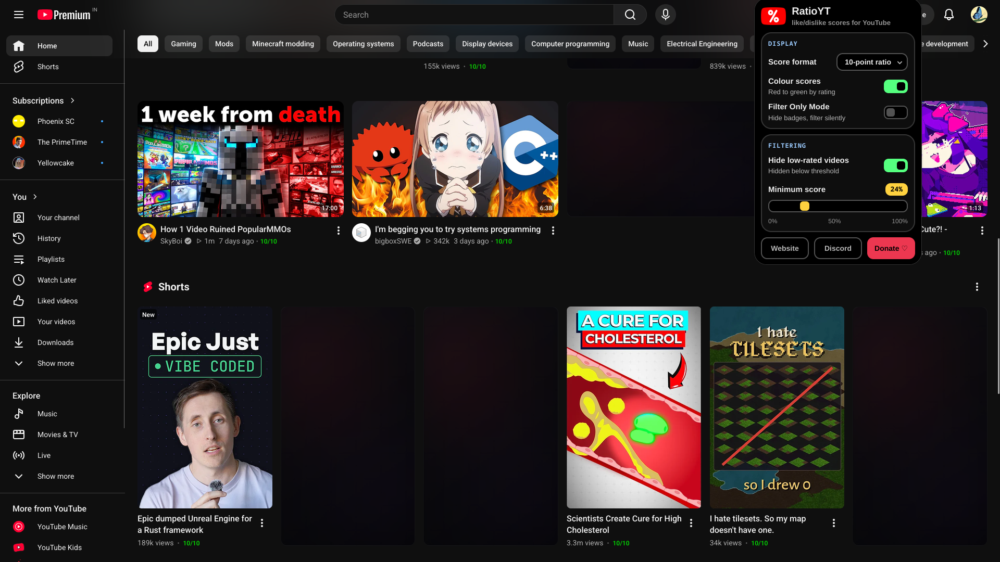

<div align="center">

# RatioYT

### A lightweight browser extension & userscript that brings like/dislike ratios back to YouTube.

[](https://bittu.dev/discord)
[](https://github.com/Bittu5134/RatioYT/blob/main/LICENSE)

<br>


</div>

## How It Works

- Video cards on Home, Search, Shorts, and sidebar recommendations are scanned as you browse.
- Dislike counts and like ratios are fetched from the [Return YouTube Dislike API](https://returnyoutubedislike.com/).
- Rating scores are displayed cleanly alongside video metadata in your preferred format.
- Clickbait and poorly-rated videos below your threshold are automatically replaced with a clean placeholder.
- Fetched scores are cached locally in your browser's IndexedDB for **7 days** to minimize network calls.

## Install

| Platform | Link |
|---|---|
| **Chrome** | [Chrome Web Store](https://chromewebstore.google.com/detail/ratioyt) |
| **Firefox** | [Firefox Add-ons](https://addons.mozilla.org/firefox/addon/ratioyt/) |
| **Brave** | [Chrome Web Store](https://chromewebstore.google.com/detail/ratioyt) |
| **Edge** | [Edge Add-ons](https://microsoftedge.microsoft.com/addons/detail/ratioyt) |
| **Userscript** | [Install `ratioyt.user.js`](https://ratioyt.bittu.dev/ratioyt.user.js) |

> [!TIP]
> The userscript version is compatible with Violentmonkey, Tampermonkey, and Greasemonkey. Pre-built packages and releases are also available on [GitHub Releases](https://github.com/Bittu5134/RatioYT/releases).

## Features

- **Extension or Userscript** — Install as a standalone browser extension or run as a lightweight userscript with full settings support.
- **Like/dislike ratios on cards** — Shown on Home, Search, Shorts, and sidebar recommendations.
- **Hide clickbait by score** — Videos scoring below your chosen threshold are replaced with empty placeholders.
- **Four rating formats** — Choose between Percentage (`96%`), 10-point (`9.6/10`), smileys (`😊` `😐` `😞`), or ★★★★★.
- **Red-to-green colouring** — Badge colour shifts with the score, so low and high ratings stand out at a glance.
- **Filter Only Mode** — Keeps low-rated video filtering active while hiding the score badges from your feed.
- **7-day local cache** — Ratings are stored in your browser's IndexedDB, so repeat visits don't hit the network.
- **Open source, no tracking** — Free software under GPL-3.0. Zero analytics, no accounts, and no telemetry.

## Showcase

<div align="center">

### Star Ratings Format
Ratings displayed as 5-star badges directly on YouTube video cards:


<br><br>

### Percentage Badges Format
Live like/dislike ratios displayed as percentage badges with dynamic color grading:



<br><br>

### Settings & Clickbait Threshold Filter
Configure rating styles, color grading, and threshold sliders to filter low-rated videos:



</div>

## Settings

Settings can be customized directly in the extension popup or via the web dashboard at [ratioyt.bittu.dev/popup](https://ratioyt.bittu.dev/popup/):

- **Score Format** — Percentage · 10-point ratio · Smiley faces · Star rating
- **Colour Scores** — Dynamic red-to-green gradient based on rating
- **Filter Only Mode** — Filter clickbait silently without showing badges
- **Hide Low-Rated Videos** — Toggle replacing low-scoring cards
- **Minimum Score** — Adjustable threshold slider (0–100%)

> [!NOTE]
> The web settings dashboard at `https://ratioyt.bittu.dev/popup/` syncs directly with both the browser extension and the userscript in real-time.

## Run Locally

```bash
# Clone the repository
git clone https://github.com/Bittu5134/RatioYT.git && cd RatioYT
npm install

# Start development server
npm run dev
```

### Build

```bash
# Build browser extension (Chrome)
npm run build

# Build browser extension (Firefox)
npm run build:firefox

# Build standalone userscript
npm run build:userscript

# Build all targets
npm run build:all
```

## Built Using

[Extension.js](https://extension.js.org/) · [Return YouTube Dislike API](https://returnyoutubedislikeapi.com/) · [Vanilla JS](https://developer.mozilla.org/en-US/docs/Web/JavaScript)

<br>

---

<div align="center">

RatioYT · Free software under [GPL-3.0](https://github.com/Bittu5134/RatioYT/blob/main/LICENSE) · by [Bittu](https://bittu.dev)

[Website](https://ratioyt.bittu.dev) · [Discord](https://bittu.dev/discord) · [Email](mailto:hello@bittu.dev) · [Patreon ❤️](https://www.patreon.com/cw/LazyBittu)

</div>
